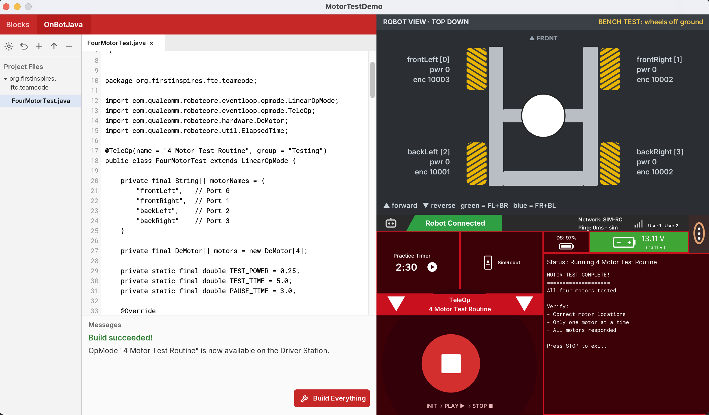

# FTC OpMode Sim

A Processing library that lets students write and run real FTC SDK OpMode code and watch a 2D simulation of their robot, before they ever touch real hardware.

Students write the same Java they would put on a real robot. The code they write in the sim pastes onto a real robot unchanged.



## What's in the window

- **Editor (left):** an OnBot Java-style editor. Type your OpMode, press **Build Everything**, and see "Build succeeded!" or compile errors with line numbers.
- **Robot view (top right):** a top-down mecanum chassis on a bench (wheels off the ground). Each wheel shows its name, port, power, encoder count and a spin arrow. The center circle shows the robot's direction for the 10 standard mecanum moves.
- **Driver Station (bottom right):** modeled on the real Driver Station. Select the OpMode, press INIT → PLAY → STOP, and read live telemetry.

## Features (v1)

- Real FTC SDK code: `LinearOpMode`, `@TeleOp` / `@Autonomous`, `hardwareMap`, `DcMotor`, `telemetry`, `ElapsedTime`
- Four drive motors, fixed configuration: `frontLeft` (0), `frontRight` (1), `backLeft` (2), `backRight` (3)
- Real motor mirroring: left motors spin backward at positive power until you call `setDirection(DcMotor.Direction.REVERSE)`
- Simulated encoder counts
- Real Driver Station error when a hardware name is wrong
- Your OpMode is compiled while the sim is running, so a typo never stops the window from opening

## Requirements

- Processing 4.5.7 (the sim uses Processing's built-in Java to compile your code)
- JDK 17 and git (to build the library)
- Tested on macOS. Windows and Linux are untested.

## Install

```
git clone https://github.com/theantonius/ftc-opmode-sim.git
cd ftc-opmode-sim
./gradlew build
```

This builds the library and installs it into your Processing sketchbook as `ftcopmodesim`.

## Run the example

1. In Processing, open **File → Examples → Contributed Libraries → FTC OpMode Sim → MotorTestDemo**.
2. Press Run.
3. Edit `FourMotorTest.java` in the editor and press **Build Everything**.
4. On the Driver Station, press **INIT**, then **PLAY**. Press **STOP** to end.

Your OpMode is saved in the sketch's `data/` folder as a normal `.java` file, ready to copy onto a real robot.

## Writing your own OpMode

- v1 runs one OpMode: the `.java` file in the sketch's `data/` folder.
- The public class name must match the file name (for example `FourMotorTest` in `FourMotorTest.java`).
- The name on the Driver Station comes from `@TeleOp(name = "...")` or `@Autonomous(name = "...")`.

## Troubleshooting

- **Library doesn't show up in Processing:** restart Processing after `./gradlew build`.
- **Processing isn't in `/Applications`:** the build looks for Processing's core jar in `/Applications/Processing.app`. If Processing is somewhere else, pass the path: `./gradlew build -PprocessingCore=/path/to/core.jar` (inside Processing.app it's in `Contents/app/resources/core/library/`).
- **"No Java compiler available":** run the sketch from Processing, which includes the compiler the sim needs.
- **"No OpMode found":** add `@TeleOp` or `@Autonomous` to your class.

## Project layout

```
src/main/java/com/qualcomm/...      FTC SDK stand-ins (same package names as the real SDK)
src/main/java/org/firstinspires/... FTC SDK stand-ins
src/main/java/org/nycfirst/opmodesim/  the simulator, editor and Driver Station
examples/MotorTestDemo/             demo sketch; student OpMode lives in data/
sketches/                           development test sketches
test-opmodes/                       OpModes used to test the sim
```

## Roadmap

- Gamepad support
- Multiple OpModes
- Servos and sensors
- Robot moving on a field
- p5.js web version

## License

Copyright (c) 2026 Antonius Wiriadjaja. Licensed under LGPL-2.1. See [LICENSE](LICENSE). Bundled fonts (Inter, Roboto Mono) are under the SIL Open Font License; see the license files next to the fonts.

## About

Built by Antonius Wiriadjaja at NYC FIRST for robotics education.

FIRST® and FIRST® Tech Challenge are trademarks of FIRST. REV Robotics is a trademark of REV Robotics. This is not an official FIRST or REV Robotics product. The FTC SDK classes in this library are independent stand-ins written for the simulator, not FTC SDK code. All icons were drawn for this project.
